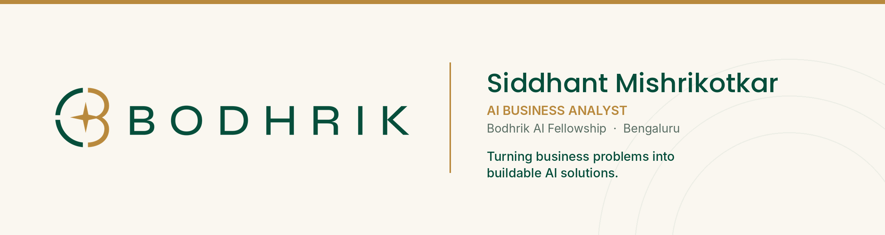

<picture>
  <source media="(prefers-color-scheme: dark)" srcset="./assets/banner-dark.png">
  <source media="(prefers-color-scheme: light)" srcset="./assets/banner-light.png">
  
</picture>

  
  
  
  

 

## About me

<!-- TO DO: add the Bodhrik AI Certification and review milestones once completed -->

I'm an **AI Business Analyst** at [Bodhrik](https://bodhrik.com/), part of the Bodhrik AI Fellowship. I sit between business stakeholders and engineering: I find out how a business actually runs, spot where AI can make it faster or smarter, and turn that into specs the team can build from.

I come from a programming background (C, C++, Java, C#, Python), so I can follow the technical side of a project as well as the business side.

> [!NOTE]
> **AI drafts, humans decide.** Everything an AI tool produces for me gets checked, corrected and annotated before it's final.

 

## 🧭 What I do

<table>
  <tr>
    <td width="50%" valign="top">
      <h4>📋 Requirements</h4>
      Stakeholder interviews, user stories and functional specs for AI-driven solutions.
    </td>
    <td width="50%" valign="top">
      <h4>🔀 Process mapping</h4>
      As-is / to-be workflows, and spotting where AI improves efficiency or decisions.
    </td>
  </tr>
  <tr>
    <td valign="top">
      <h4>📊 Data analysis</h4>
      Python, SQL and Excel, plus AI/LLM tools, to evaluate business processes.
    </td>
    <td valign="top">
      <h4>📝 Documentation</h4>
      Research turned into clear docs, with a visible human-review layer.
    </td>
  </tr>
  <tr>
    <td valign="top">
      <h4>🤝 Coordination</h4>
      Bridging the technical team and business and customer stakeholders.
    </td>
    <td valign="top">
      <h4>🎯 Reporting</h4>
      Reports and presentations for clients and leadership.
    </td>
  </tr>
</table>

 

## 🛠️ Tech stack

  
  
  
  
  
  
  
  
  
  

<b>🌱 What I'm learning at Bodhrik</b>

 

| # | Area |
|--:|------|
| 1 | Prompt engineering and LLM tools |
| 2 | Loop and harness engineering |
| 3 | Backend development and databases |
| 4 | UI/UX |
| 5 | Cloud |

<b>🌍 Languages I speak</b>

 

| Language | Level |
|----------|-------|
| English | Fluent |
| Hindi | Fluent |
| Marathi | Fluent |
| German | Learning |

 

## 💡 How I work

| | |
|---|---|
| **Problem first, tech second** | Understand the business need before choosing a tool. |
| **AI drafts, humans decide** | Verify every AI output before it leaves my desk. |
| **Write it down** | If it isn't documented clearly, it isn't done. |

 

---

  <i>"Adaptable and resourceful, with a commitment to lifelong learning and collaboration."</i>
    
  <a href="https://bodhrik.com/"><b>Bodhrik Technologies</b></a> · Bengaluru, India

<!-- Client names, project details, prompts, datasets and internal tools are confidential. Do not add them here. -->
